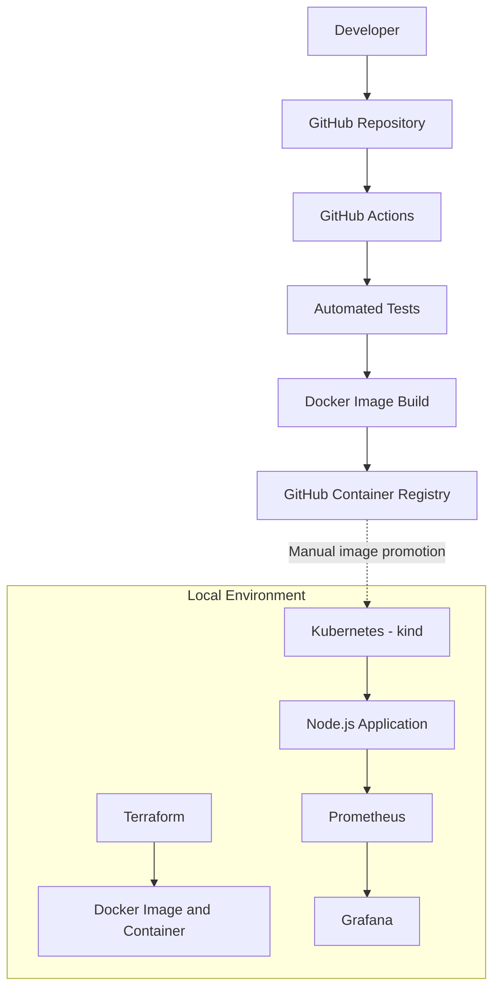
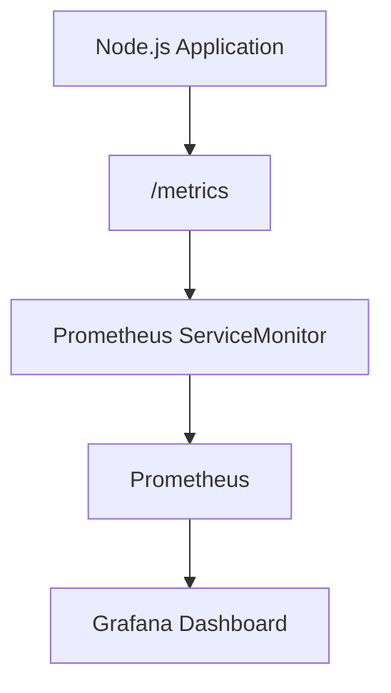
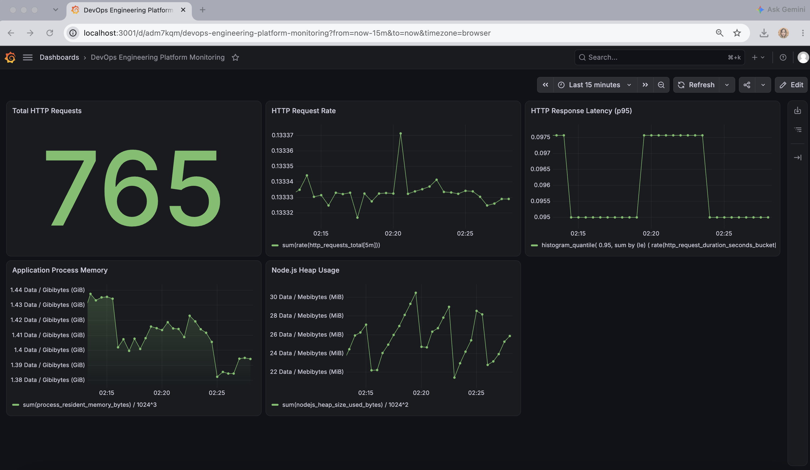
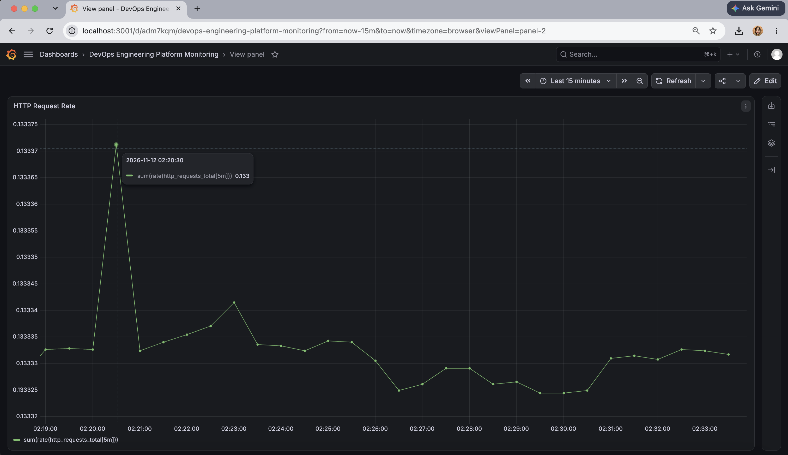
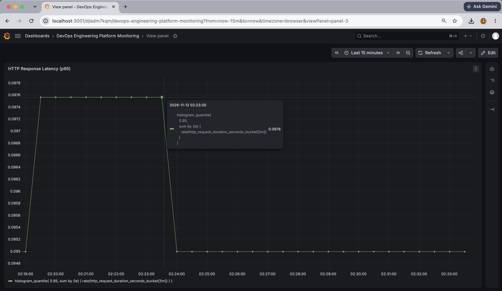
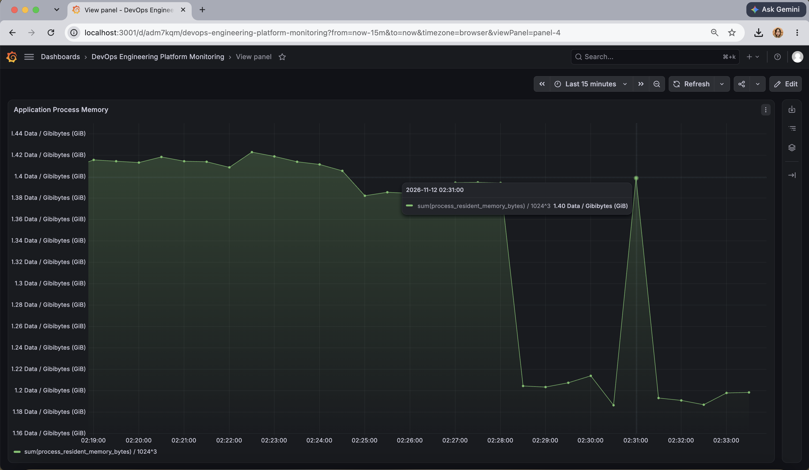
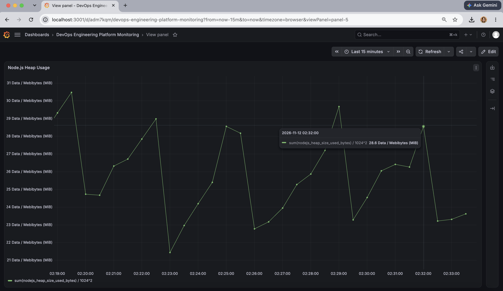

# Enterprise DevOps Engineering Platform

A hands-on DevOps engineering project demonstrating application containerization, infrastructure as code, Kubernetes orchestration, CI/CD automation, and application observability.

This is a locally implemented MVP designed to demonstrate how modern DevOps tools work together across an application delivery lifecycle.

**Implementation scope:** Local development and infrastructure emulation. No production AWS infrastructure is provisioned.

## 1. Project Overview

The platform demonstrates:

- Node.js application development and automated testing
- Docker image creation and containerization
- Infrastructure provisioning using Terraform
- Container orchestration using Kubernetes
- CI/CD automation using GitHub Actions
- Container image publishing using GitHub Container Registry (GHCR)
- Application metrics collection using Prometheus
- Metrics visualization using Grafana

## 2. Architecture

The project demonstrates two separate local deployment approaches:

1. Terraform provisions a Docker image, network, and standalone application container.
2. Kubernetes runs the application using a Deployment with two replicas and exposes it through a Service.

GitHub Actions automates testing, Docker image building, and publishing to GHCR. Kubernetes image promotion is currently performed manually.

Prometheus collects application metrics, while Grafana provides monitoring dashboards.

### High-Level Architecture



### Monitoring Architecture



## 3. Technology Stack

| Category | Technology | Purpose |
|---|---|---|
| Application | Node.js | Application runtime |
| Framework | Express.js | HTTP application |
| Testing | Node.js Test Runner, Supertest | Automated testing |
| Containerization | Docker | Application packaging |
| Local infrastructure | Terraform | Docker resource provisioning |
| Orchestration | Kubernetes (kind) | Container orchestration |
| CI/CD | GitHub Actions | Automated testing and image publishing |
| Container registry | GHCR | Docker image storage |
| Monitoring | Prometheus | Metrics collection |
| Visualization | Grafana | Monitoring dashboards |
| Package management | Helm | Monitoring stack installation |

## 4. Repository Structure

```text
devops-engineering-platform/
├── .gitignore
├── Dockerfile
├── compose.yaml
├── package.json
├── package-lock.json
├── src/
│   ├── app.js
│   └── server.js
├── tests/
│   └── app.test.js
├── terraform/
│   ├── main.tf
│   ├── providers.tf
│   ├── variables.tf
│   ├── outputs.tf
│   ├── versions.tf
│   └── .terraform.lock.hcl
├── kubernetes/
│   ├── deployment.yaml
│   └── service.yaml
└── monitoring/
    └── devops-platform-servicemonitor.yaml
```

The GitHub Actions workflow is maintained at the portfolio repository root:

`.github/workflows/ci.yml`

## 5. Application

The application is built using Node.js and Express.

### Available Endpoints

| Endpoint | Description |
|---|---|
| `/` | Application homepage |
| `/health` | Application health check |
| `/ready` | Application readiness check |
| `/metrics` | Prometheus metrics endpoint |

The application exposes HTTP request counters, request duration histograms, and Node.js runtime metrics.

## 6. Infrastructure as Code

Terraform uses the Docker provider to provision three resources:

- Docker image
- Docker network
- Docker container

The configuration builds the application image, creates a dedicated network, and runs the container with production environment variables.

Run these commands from the portfolio repository root:

```bash
terraform -chdir=labs/devops-engineering-platform/terraform init
terraform -chdir=labs/devops-engineering-platform/terraform validate
terraform -chdir=labs/devops-engineering-platform/terraform plan
terraform -chdir=labs/devops-engineering-platform/terraform apply
```

To remove the Terraform-managed local resources:

```bash
terraform -chdir=labs/devops-engineering-platform/terraform destroy
```

## 7. Containerization

Docker packages the Node.js application into a container image.

The Docker configuration uses:

- Node.js Alpine base image
- Production dependency installation
- Non-root container execution
- Port 3000 exposure

Docker Compose provides an additional way to run the application locally.

From the application directory:

```bash
docker build -t devops-platform:1.0 .
docker compose up -d
```

Application health check:

```bash
curl http://localhost:3000/health
```

## 8. Kubernetes Deployment

The project uses kind to run a local Kubernetes cluster.

The Kubernetes Deployment maintains two application replicas. The Kubernetes Service exposes the application through a NodePort configuration.

### Kubernetes Resources

| Resource | Purpose |
|---|---|
| Deployment | Maintains two application replicas |
| Pods | Run application containers |
| Service | Exposes the application |
| ServiceMonitor | Defines Prometheus scraping configuration |

### Useful Commands

```bash
kubectl get nodes
kubectl get deployments
kubectl get pods
kubectl get services
```

Access the application locally using port forwarding:

```bash
kubectl port-forward service/devops-platform-service 8080:3000
```

Then visit `http://localhost:8080`.

## 9. CI/CD Pipeline

GitHub Actions automates application validation and container image publishing.

### Pipeline Workflow

1. Check out source code.
2. Set up Node.js.
3. Install dependencies using `npm ci`.
4. Run automated tests.
5. Build the Docker image.
6. Authenticate with GitHub Container Registry.
7. Build and publish multi-platform images.

Images are published to:

`ghcr.io/lnyfgio/devops-platform`

The pipeline publishes the `latest` tag and a commit-specific tag.

**Deployment note:** Kubernetes image promotion is currently a manual operation. The workflow automates CI and image publishing, not a fully automated Kubernetes deployment.

## 10. Monitoring and Observability

The project uses Prometheus and Grafana for application monitoring.

### Prometheus

Prometheus collects application metrics from the `/metrics` endpoint.

A Kubernetes ServiceMonitor discovers the application Service and configures metric scraping every 15 seconds.

### Grafana

The project includes a dashboard named **DevOps Engineering Platform Monitoring**, , providing visibility into application traffic, response performance, and resource utilization.

#### Dashboard Overview

The dashboard contains five panels:

| Panel | Metric |
|---|---|
| Total HTTP Requests | Cumulative HTTP requests |
| HTTP Request Rate | Requests per second |
| HTTP Response Latency (p95) | 95th percentile response duration |
| Application Process Memory | Process resident memory |
| Node.js Heap Usage | JavaScript heap utilization |

### Dashboard Overview

The dashboard visualizes application traffic, HTTP response latency,
process memory consumption, and Node.js heap utilization.



#### Application Performance

**HTTP Request Rate**

Tracks the number of incoming HTTP requests per second.



**HTTP Response Latency (p95)**

Measures the 95th percentile HTTP response duration, helping identify slower application responses.



#### Resource Monitoring

**Application Process Memory**

Tracks the application's resident process memory consumption.



**Node.js Heap Usage**

Monitors memory consumed by the Node.js JavaScript heap.



## 11. Project Scope and Limitations

This is a local DevOps MVP intended for hands-on learning and technical demonstration.

Current implementation boundaries:

- Terraform provisions local Docker resources, not AWS infrastructure.
- Kubernetes runs through a local kind cluster.
- GitHub Actions publishes images to GHCR.
- Kubernetes deployment updates are manually promoted.
- Prometheus and Grafana run within the local Kubernetes environment.
- The monitoring dashboard is intended for local demonstration, not public production access.

## 12. Future Enhancements

Potential future improvements include:

- AWS infrastructure emulation using Floci
- Real AWS deployment using Terraform
- Automated Kubernetes deployment
- Additional alerting and operational dashboards
- Enhanced deployment and rollback automation

These are future enhancements and are not part of the current implementation.

---

**Project:** Enterprise DevOps Engineering Platform

**Status:** Local MVP implemented and demonstrated

**Repository Owner:** [lnyfgio](https://github.com/lnyfgio)
